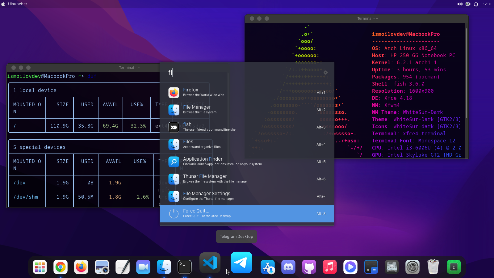

# de-config

Linux ish stoli muhitlarini (Desktop Environment) macOS ko'rinishiga keltirish uchun konfiguratsiya fayllari, mavzular va o'rnatuvchi skriptlar.



## Qo'llanmalar

| Jild | DE | Distributiv | Qo'llanma |
|---|---|---|---|
| [`xfce4-macos-config/`](xfce4-macos-config/) | XFCE4 | Arch Linux / Manjaro | [README](xfce4-macos-config/README.md) |
| [`gnome-macos-config/`](gnome-macos-config/) | GNOME | Ubuntu / Debian | [README](gnome-macos-config/README.md) |

## Tez boshlash

**XFCE4 (Arch Linux / Manjaro):**

```bash
git clone https://github.com/ismoilovdevml/de-config.git
cd de-config/xfce4-macos-config
bash installer.sh
```

**GNOME (Ubuntu / Debian):**

```bash
git clone https://github.com/ismoilovdevml/de-config.git
cd de-config/gnome-macos-config
bash installer.sh
```

Skriptlarni `sh` bilan emas, `bash` bilan ishga tushiring — ular bash sintaksisidan foydalanadi.

O'rnatuvchi barcha ishni bajarmaydi: qolgan qo'lda bajariladigan qadamlar (panel, Plank, Ulauncher, terminal sozlamalari) har bir jildning README faylida rasmlar bilan tushuntirilgan.

## Repozitoriya tarkibi

| Jild | Tavsif |
|---|---|
| `xfce4-macos-config/` | XFCE4 konfiguratsiyasi: fontlar, Plank va Ulauncher mavzulari, Apple menyusi (`xpple_menu`), Monterey GRUB mavzusi |
| `gnome-macos-config/` | GNOME konfiguratsiyasi: WhiteSur mavzu/ikonka nusxasi, Plank mavzulari |
| `wallpapers/` | Fon rasmlari to'plami |
| `assets/` | Qo'llanmalar uchun ekran suratlari |
| `icons/` | Apple menyusi va Launchpad ikonkalari |

> **Diqqat:** `wallpapers/` jildi ~474 MB. Faqat konfiguratsiya kerak bo'lsa, repozitoriyani to'liq clone qilish shart emas:
>
> ```bash
> git clone --depth 1 --filter=blob:none --sparse https://github.com/ismoilovdevml/de-config.git
> cd de-config
> git sparse-checkout set xfce4-macos-config assets icons
> ```

## Manbalar

Ushbu konfiguratsiya quyidagi open-source loyihalarga tayanadi:

* [WhiteSur GTK theme](https://github.com/vinceliuice/WhiteSur-gtk-theme) — vinceliuice
* [WhiteSur icon theme](https://github.com/vinceliuice/WhiteSur-icon-theme) — vinceliuice
* [WhiteSur cursors](https://github.com/vinceliuice/WhiteSur-cursors) — vinceliuice
* [vala-panel-appmenu](https://gitlab.com/vala-panel-project/vala-panel-appmenu)
* [Monterey GRUB theme](https://github.com/vinceliuice/grub2-themes) — techsan
* [SanFrancisco fonts](https://github.com/AppleDesignResources/SanFranciscoFont)
* [Plank](https://launchpad.net/plank) · [Ulauncher](https://ulauncher.io/)

## Litsenziya

[MIT](LICENSE)

Kiritilgan uchinchi tomon mavzulari va fontlar o'z litsenziyalari ostida tarqatiladi.

## Muallif

**Otabek Ismoilov**

* [Veb-sayt](https://ismoilovdev.vercel.app/)
* [Telegram Blog](https://t.me/Otabek_Ismoilov)
* [GitHub](https://github.com/ismoilovdevml)

Hamjamiyat: [Xinux](https://xinux.uz) · [Telegram](https://t.me/xinuxuz)
