# XFCE4 macOS Theme

XFCE4 ish stoli muhitini macOS ko'rinishiga keltirish bo'yicha qo'llanma.

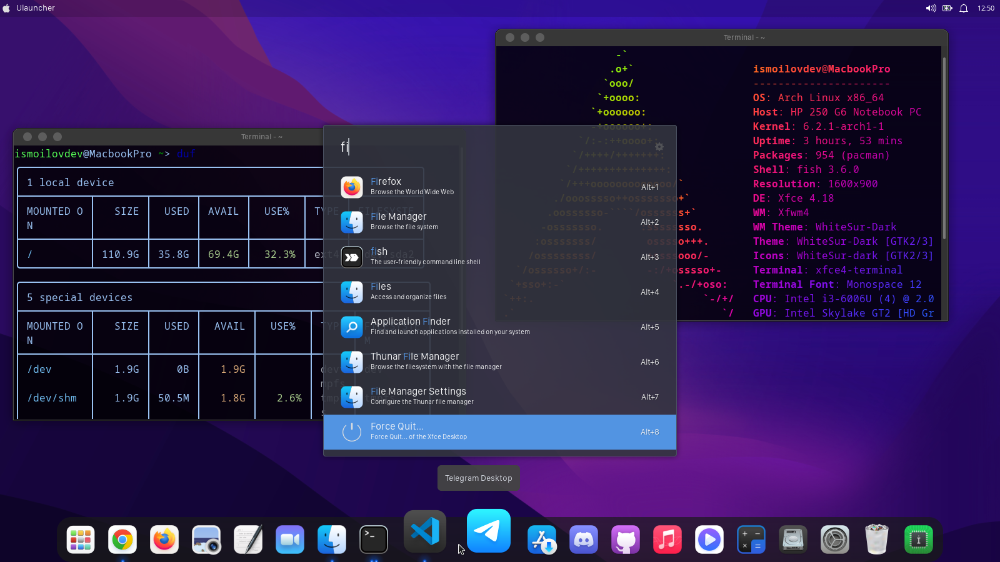

## Talablar

* Arch Linux yoki Manjaro
* XFCE4 (LightDM bilan)
* AUR helper: `yay` yoki `paru`

> **Eslatma:** ushbu konfiguratsiya Manjaro'da sinovdan o'tgan. Toza Arch Linuxda `pamac` o'rniga `yay`/`paru` ishlatiladi — quyida kerakli joylarda ikkala variant ko'rsatilgan.

AUR helper o'rnatilmagan bo'lsa, avval uni o'rnatib oling:

```bash
sudo pacman -S --needed git base-devel
git clone https://aur.archlinux.org/yay.git
cd yay && makepkg -si
```

## Ishni boshlash

Konfiguratsiya fayllari va kodlarini GitHubdan yuklab olamiz:

```bash
git clone https://github.com/ismoilovdevml/de-config.git
cd de-config/xfce4-macos-config
```

## O'rnatuvchi

Terminalda ko'p ishlashga to'g'ri kelgani, bu ancha vaqt olishi va yangi foydalanuvchilar uchun qiyin bo'lgani uchun jarayonni qisqartirish va soddalashtirish maqsadida `installer.sh` skripti yozilgan. Bu skript asosiy konfiguratsiyalarni avtomatik o'rnatadi va sozlaydi.

O'rnatuvchini ishga tushirish uchun `de-config/xfce4-macos-config` jildiga kirib skriptni bajaring:

```bash
bash installer.sh
```

> **Muhim:** skriptni `sh installer.sh` bilan ishga tushirmang — u bash sintaksisidan foydalanadi, `sh` bilan xato beradi. `bash installer.sh` yoki `chmod +x installer.sh && ./installer.sh` deb yozing.

Skript o'rnatish va sozlash uchun biroz ko'proq vaqt olishi mumkin. Bu sizning internet tezligingizga va kompyuteringiz quvvatiga bog'liq.

Skript quyidagilarni bajaradi: kerakli paketlar va fontlarni o'rnatadi, WhiteSur GTK mavzusi, ikonkalari va kursorlarini upstream'dan yuklab o'rnatadi, fon rasmlarini `~/Pictures/wallpapers` ga ko'chiradi, `.desktop` fayllari va Apple menyusi konfiguratsiyasini joylashtiradi.

Skript tugagandan so'ng qolgan qadamlarni qo'lda bajaramiz.

## Desktop sozlamalari

Sozlamalardan `Desktop` bo'limini tanlaymiz va quyidagi rasm bilan bir xil qilib sozlab olamiz:

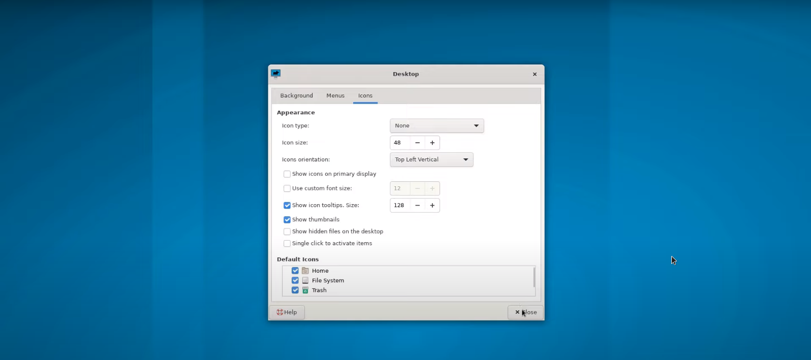

Sozlamalardan `Window Manager Tweaks` bo'limiga kirib, uni ham rasmdagidek sozlab olamiz:

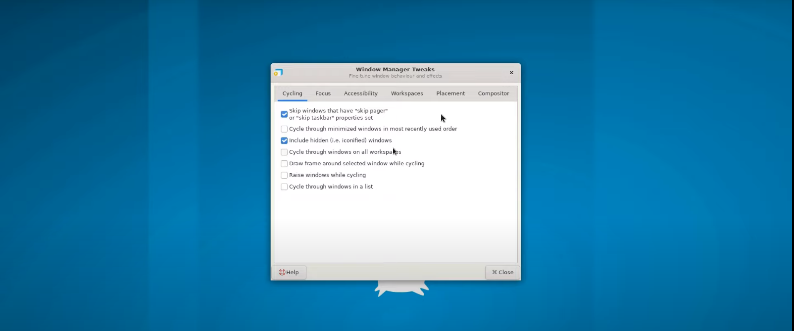

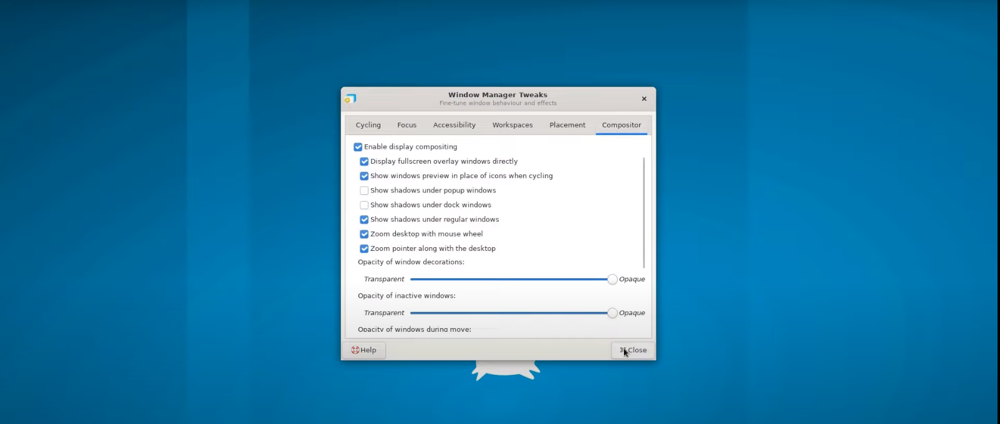

## Fon rasmlarini ulash

`installer.sh` fon rasmlarini `~/Pictures/wallpapers` ga o'zi ko'chiradi. Agar qo'lda qilmoqchi bo'lsangiz, `wallpapers/` jildi repozitoriyning **ildizida** joylashgan (`xfce4-macos-config` ichida emas):

```bash
cd de-config
cp -r wallpapers/ ~/Pictures/
```

Sozlamalardan `Desktop` bo'limiga o'tib, `Folder` ga bosib `Other...` ni tanlaymiz va `~/Pictures/wallpapers` jildini ko'rsatib ulaymiz:

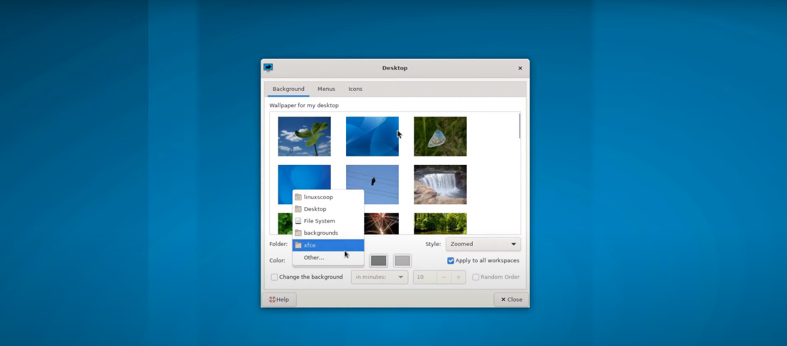

## Fayl menejerini sozlash

Jildlarni tartiblab yon panelga chiqarish uchun `Send to` → `Side pane` bosish orqali jildlarni side panelga chiqarib olamiz. Batafsil rasmda:

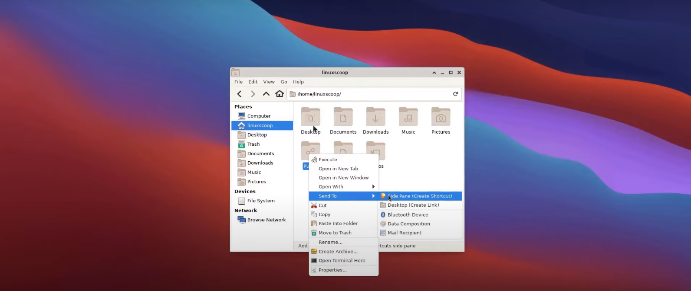

Fayl menejeri standart holda yashirin jildlar va fayllarni ko'rsatmaydi. Ularni ko'rish uchun `View` bo'limini bosib `Show Hidden Files` ni yoqib qo'yamiz:

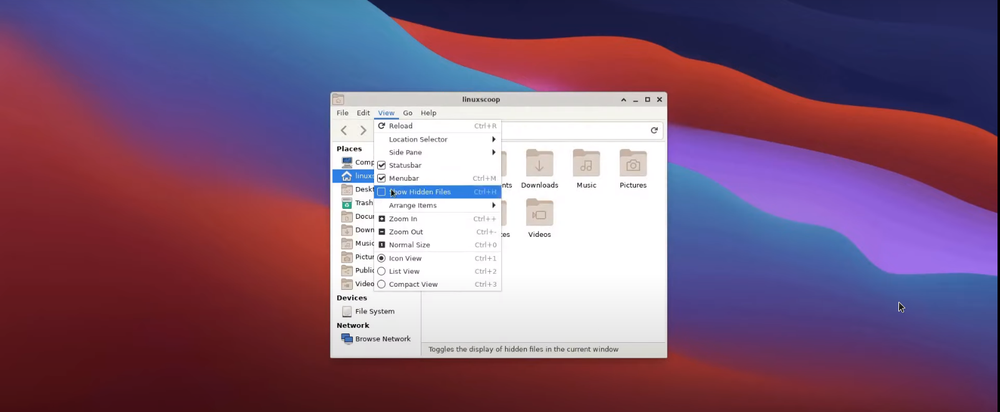

## Mavzu, ikonkalar va fontlarni joriy qilish

Hozirda bizda asosiy konfiguratsiyalar o'rnatilgan. Endi ularni DE'da joriy qilishimiz kerak.

Sozlamalar bo'limidan `Appearance` bo'limiga kiramiz:

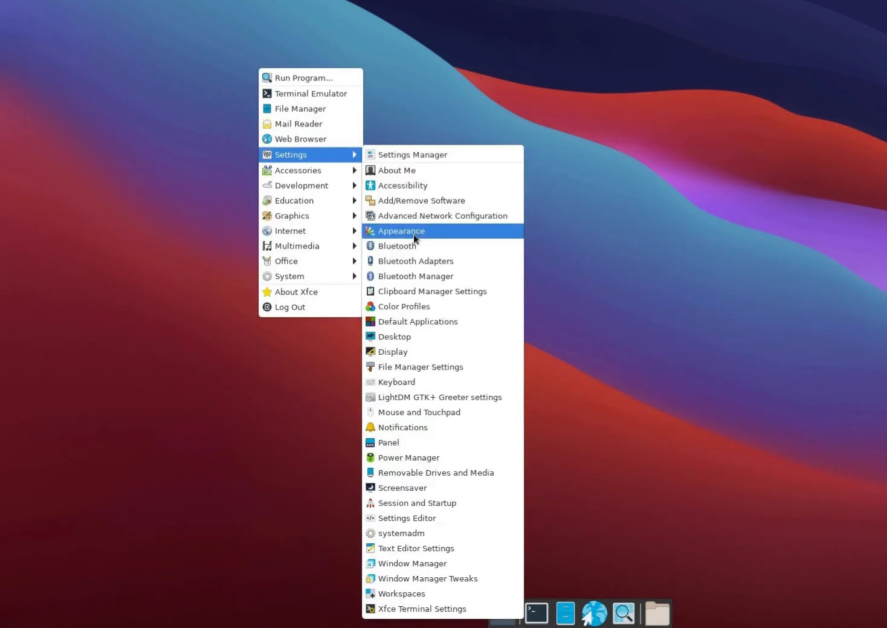

`Appearance` → `Style` bo'limiga kirib quyidagicha sozlaymiz:

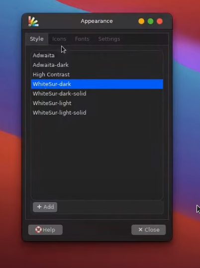

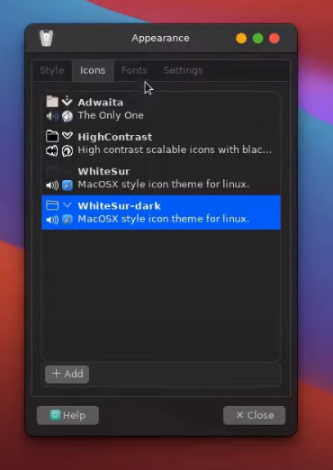

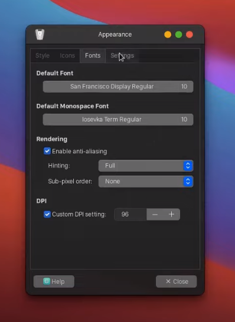

Tabriklayman, asosiy sozlamalar tugadi.

## Global menyu (Vala AppMenu)

macOS'dagidek yuqori paneldagi global menyu uchun `vala-panel-appmenu` kerak bo'ladi. Buning uchun alohida skript yozilgan — `de-config/xfce4-macos-config` jildida `global-menu.sh` ni ishga tushiring:

```bash
bash global-menu.sh
```

Skript sizdan foydalanuvchi parolini va o'rnatishga roziligingizni so'raydi. AUR'dan build qilinadigani uchun o'rnatish biroz vaqt olishi mumkin.

## XFCE panelni sozlash

Sichqonchani XFCE panel ustiga olib borib o'ng tugmasini bosib rasmdagi bo'limga kiramiz:

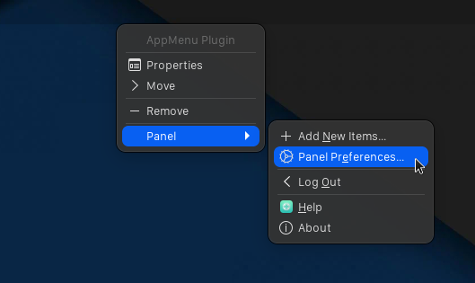

Shu bo'limdan `Items` bo'limiga o'tib quyidagicha sozlab olishimiz kerak. Rasmda ko'rsatilgan itemlar shu ketma-ketlikda bo'lishi kerak. Agar sizda rasmdagidek itemlar bo'lmasa, qo'shib oling; ortiqchalarini esa o'chirib tashlang:

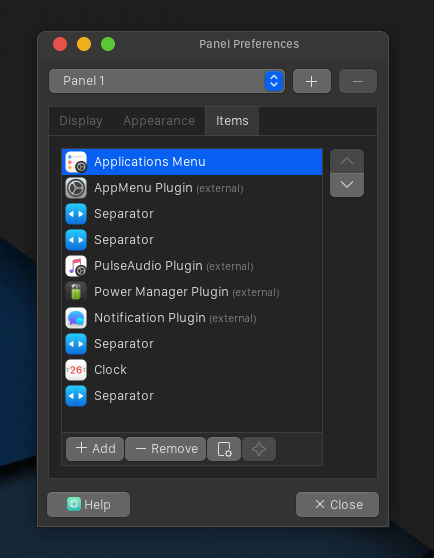

Yangi itemlar qo'shish uchun rasmdagidek amallar bajariladi. Qizil chiziq bilan chizilgan joylarga e'tibor bering:

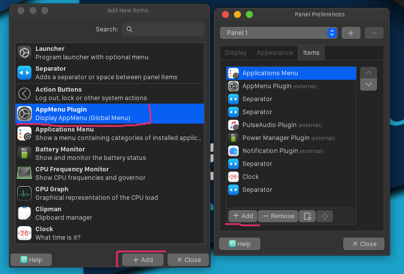

`Application Menu`-ni macOS'dagidek sozlash uchun `Items` dan `Application Menu` ustiga bosib rasmdagi amallar bajariladi:

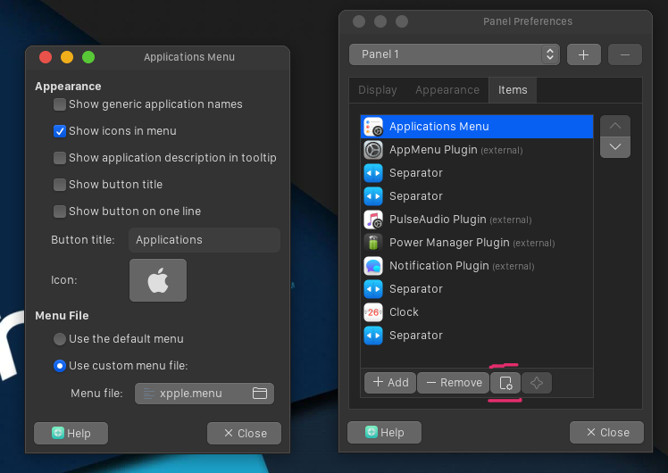

Sozlamalar rasmdagidek bo'lishi kerak. Endi ikonkani Apple ikonkasiga almashtiramiz. Ikonkani almashtirish rasmdagidek bo'ladi: qidiruv joyiga **`start-here`** deb qidiramiz va `start-here` ikonkasini tanlaymiz. Rasmdagi qizil chiziqlarga e'tibor bering:

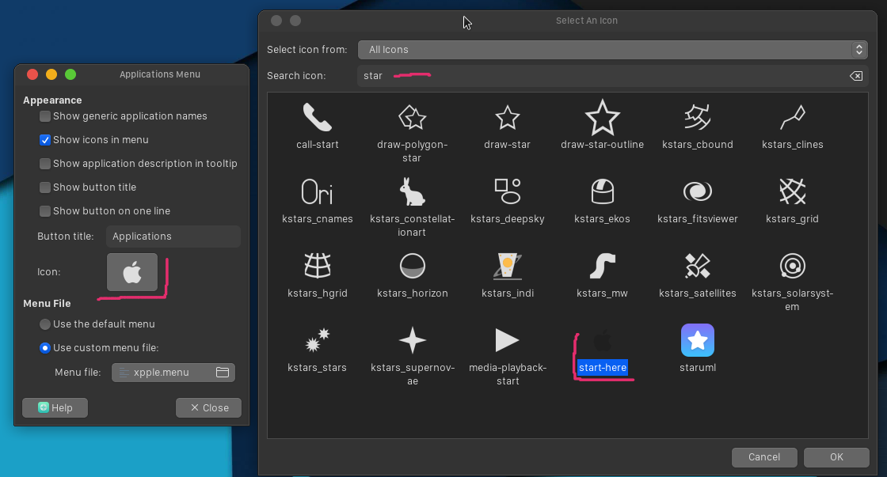

Ikonkani o'rnatganimizdan keyin unga menyu konfiguratsiya faylini ko'rsatishimiz kerak. Rasmga e'tibor bering:

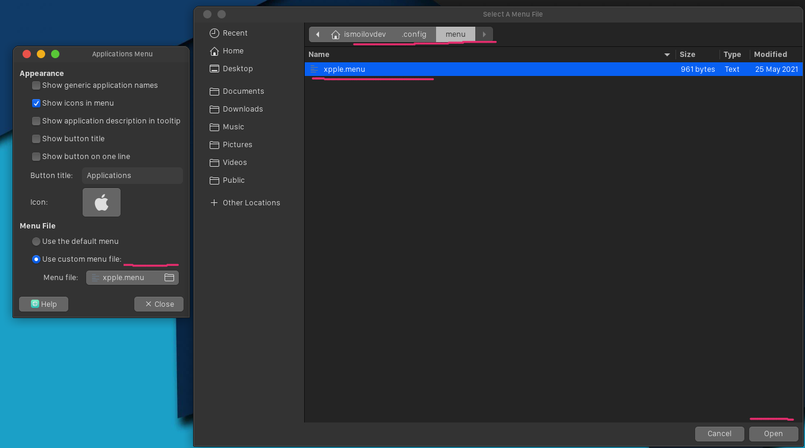

Yashirin fayllar ko'rinmasligi mumkin, shuning uchun fayl tanlash oynasida sichqonchaning o'ng tugmasini bosib `Show Hidden Files` ni yoqib qo'yasiz va `~/.config/menus/` jildidan `xpple.menu` faylini tanlaysiz. (Bu faylni `installer.sh` o'sha joyga o'zi ko'chirgan.)

## Plank Dock o'rnatish

Rasmda Plank Dock tasvirlangan:


Plank Dockni quyidagi buyruq orqali o'rnatib olamiz:

```bash
sudo pacman -S plank
```

Plank o'rnatildi, endi `Panel 2` ni o'chirib tashlashimiz kerak. Batafsil rasmda — qizil chiziqlarga e'tibor bering:

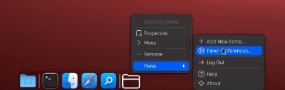

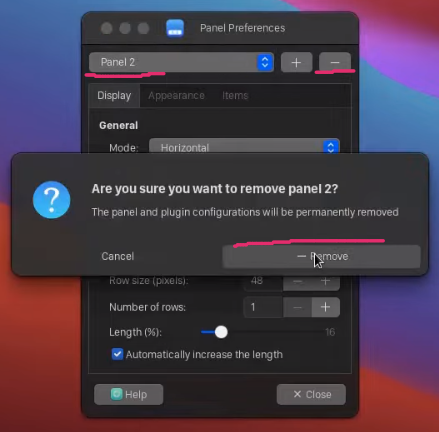

Panel o'chirilganidan keyin Plank dasturini ishga tushiramiz va uning mavzu fayllarini joylashtiramiz. Terminalni ochib `de-config/xfce4-macos-config` jildiga kiramiz:

```bash
cd plank
mkdir -p ~/.local/share/plank/themes/
cp -r theme-Dark/ theme-Light/ ~/.local/share/plank/themes/
plank --preferences
```

Plankni rasmdagidek sozlab olamiz:

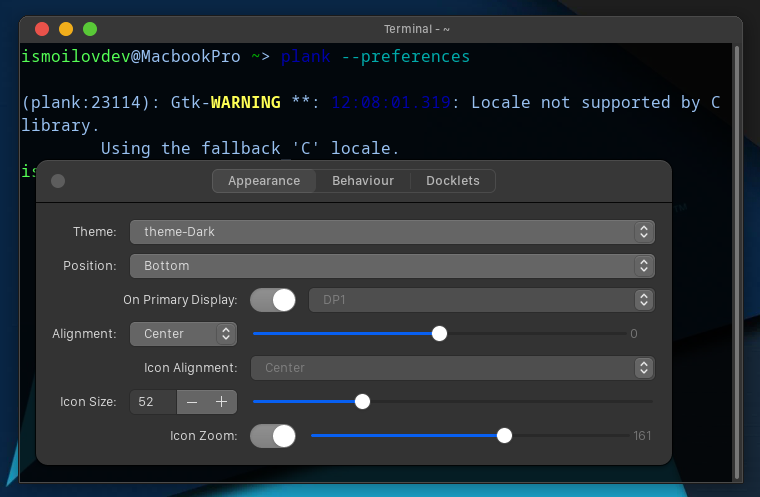

macOS'dagidek Launchpad qo'yish uchun `~/.local/share/applications/` jildiga kirib `Launchpad.desktop` faylini sichqoncha bilan bosib turib Plank dockga olib kelamiz va qo'yamiz.

Kompyuter o'chib yonganida Plank dock avtomatik ishga tushishi uchun `Settings` → `Session and Startup` bo'limiga kirib `+ Add` tugmasi bilan plankni qo'shamiz. Batafsil rasmda:

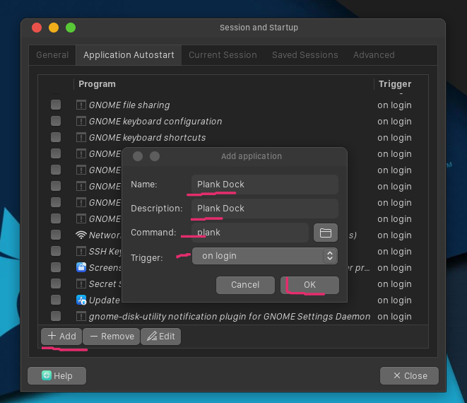

## Ulauncher o'rnatish va sozlash

Rasmda Ulauncher:

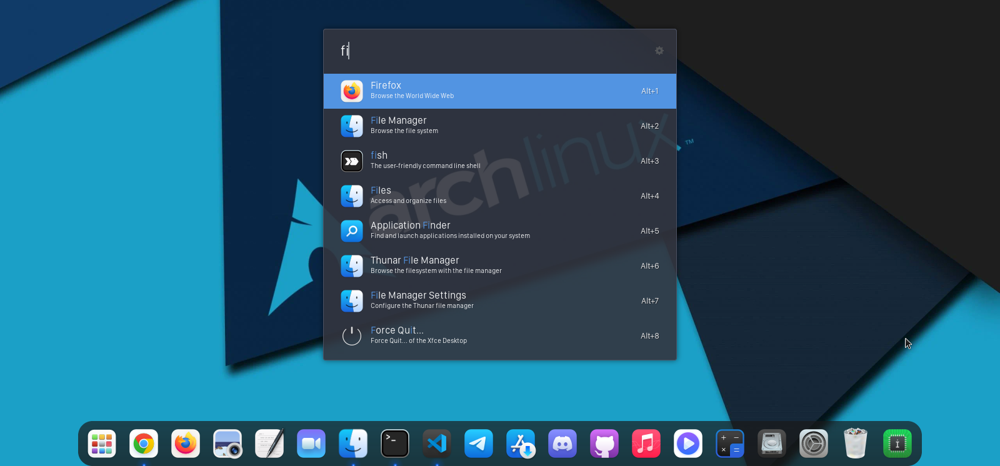

Ulauncher AUR paketi, shuning uchun AUR helper bilan o'rnatiladi:

```bash
# Arch Linux (yay yoki paru bilan)
yay -S ulauncher

# Manjaro (pamac bilan)
pamac build ulauncher
```

Ulauncher o'rnatilganidan keyin uni `Ctrl+Space` orqali ishga tushiramiz.

Keyin uning mavzu fayllarini joylashtiramiz. Terminalni ochib `de-config/xfce4-macos-config` jildiga kiramiz:

```bash
cd ulauncher_theme
mkdir -p ~/.config/ulauncher/
cp -r user-themes/ ~/.config/ulauncher/
```

Ulauncherni `Ctrl+Space` orqali chaqirib olamiz va rasmdagidek sozlaymiz:

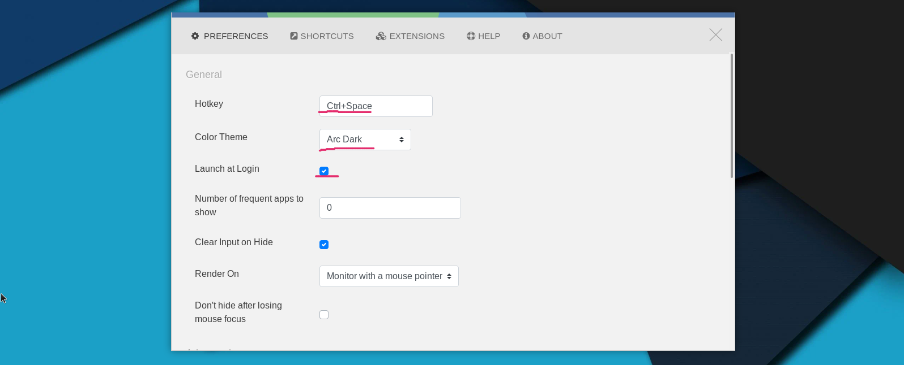

## XFCE4 terminalini sozlash

Terminalni ochib menyudan `Edit` → `Preferences` ni tanlaymiz (yoki quyidagi buyruqni yozamiz), sizda terminal sozlamalari oynasi ochiladi:

```bash
xfce4-terminal --preferences
```

Siz rasmdagidek qilib sozlab olishingiz mumkin:

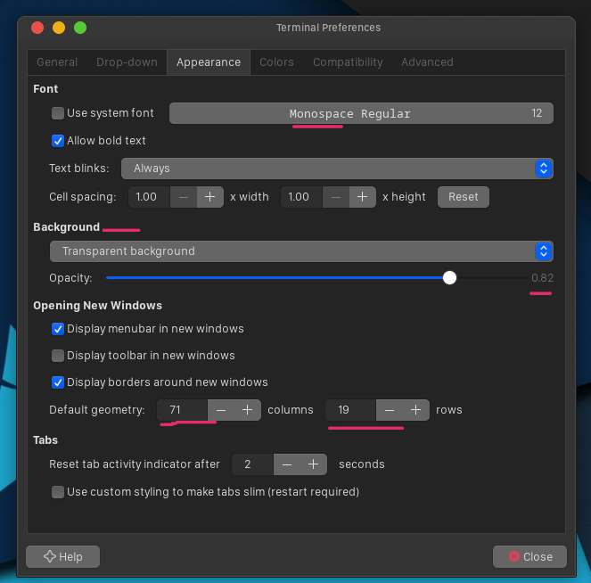

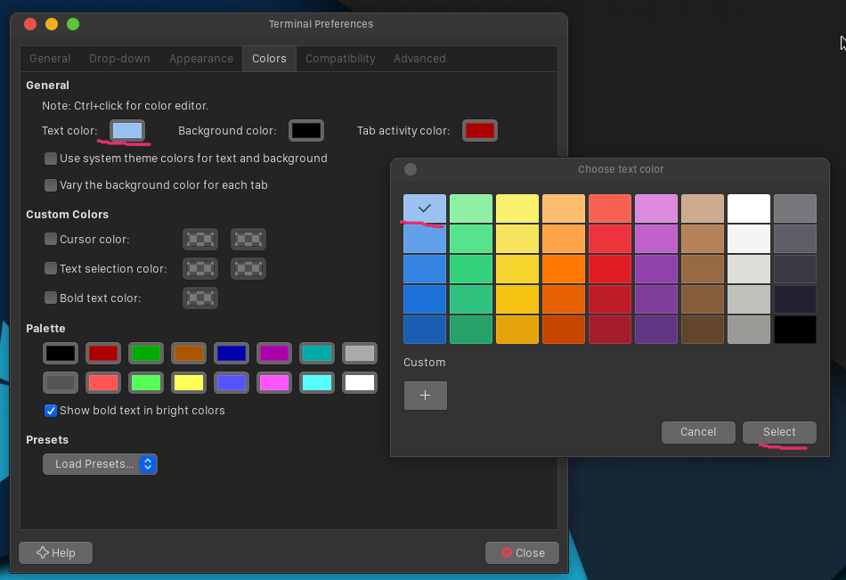

## GRUB mavzusi (ixtiyoriy)

Repozitoriyada Monterey GRUB mavzusi ham mavjud. O'rnatish uchun:

```bash
cd monterey-grub-theme
sudo bash install.sh
```

Bu skript `/etc/default/grub` faylini o'zgartiradi va `grub-mkconfig` ni qayta ishga tushiradi. Skript o'zi zaxira nusxa (`/etc/default/grub.bak`) yaratadi.

## Yakun

Nihoyat, siz bu ishni muvaffaqiyatli tugatdingiz. Tabriklayman!

Sizdagi XFCE4 ham shunday ko'rinishga keldi deb o'ylayman:


## Manbalar

Ushbu konfiguratsiya quyidagi open-source loyihalarga tayanadi:

* [WhiteSur GTK theme](https://github.com/vinceliuice/WhiteSur-gtk-theme) — vinceliuice
* [WhiteSur icon theme](https://github.com/vinceliuice/WhiteSur-icon-theme) — vinceliuice
* [WhiteSur cursors](https://github.com/vinceliuice/WhiteSur-cursors) — vinceliuice
* [vala-panel-appmenu](https://gitlab.com/vala-panel-project/vala-panel-appmenu)
* [Plank](https://launchpad.net/plank)
* [Ulauncher](https://ulauncher.io/)
